# 🌿 BrightRoot Lawn & Landscape

**BrightRoot Lawn & Landscape** is a responsive, full-stack business website designed for a fictional residential landscaping company serving Durham Region, Ontario.

The project combines an elegant, nature-inspired interface with practical customer inquiry and estimate-request workflows. Visitors can explore services and completed projects, learn about the company, submit a general inquiry, or provide detailed information for a project estimate.


---

## 🖥️ Project Preview

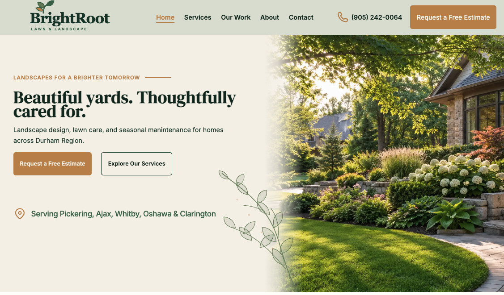

> **Deployment:** Live-demo links will be added after the frontend and backend production deployments are complete.

---

## 📖 Project Overview

BrightRoot was created as a polished portfolio project that demonstrates the complete workflow required for a modern local-service business website—from responsive user-interface implementation to working backend inquiry delivery.

The site presents landscaping services through clear visual hierarchy, project-focused imagery and simple conversion paths. Its two email workflows distinguish between visitors who have a general question and prospective clients who are ready to provide detailed project requirements.

### Business goals

- Present the company as professional, established and trustworthy
- Explain services without overwhelming prospective clients
- Showcase completed landscaping projects visually
- Convert visitors into general inquiries or estimate requests
- Provide an accessible experience across phones, tablets and desktops
- Support a realistic frontend-to-backend email workflow

---

## ✨ Core Features

- Seven fully responsive pages
- Mobile-first layout with dedicated tablet and desktop behavior
- Reusable React components and CSS Modules
- Centralized design tokens for color, typography, spacing and layout
- Service-specific links that preselect the visitor's area of interest
- General contact inquiry form
- Detailed project estimate form
- Controlled React inputs with typed form state
- Multi-select service checkboxes
- Server-side email delivery through Resend
- Separate Contact and Estimate API endpoints
- React Router navigation and custom Not Found page
- Automatic scroll restoration between routes
- Accessible labels, semantic structure and keyboard-friendly forms

---

## 🧭 Pages

### 🏡 Home

Introduces the BrightRoot brand, primary services, featured project work, company story, service area and estimate call to action.

### 🌱 Services

Explains BrightRoot's landscape design, lawn and garden care, property maintenance and seasonal services. Service-request links carry the selected service into the inquiry flow.

### 🖼️ Projects

Showcases residential landscaping work across Pickering, Ajax, Whitby, Oshawa and Clarington.

### 🌿 About

Presents the company's story, values and approach to thoughtful residential landscaping.

### ✉️ Contact

Provides company contact details and a path to the compact general-inquiry form.

### 📝 Request an Estimate

Collects contact details, property information, project type, services of interest, budget, timeline, additional notes and consent.

### 🚧 Not Found

Provides a branded fallback experience for unknown routes and guides visitors back to useful content.

---

## 📬 Inquiry and Estimate Workflow

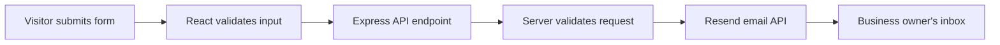

The frontend submits JSON to one of two endpoints:

```text
POST /api/contact
POST /api/estimate
```

The Express backend validates the request, formats the submitted information and sends it to the business owner through Resend. Email credentials remain on the server and are never exposed to the browser.

---

## 🧰 Technology Stack

### Frontend

- React
- TypeScript
- Vite
- React Router
- CSS Modules
- Native HTML form controls

### Backend

- Node.js
- Express
- TypeScript
- Resend email API
- CORS
- dotenv

### Development and deployment

- ESLint
- Git and GitHub
- Postman for endpoint testing
- Vercel for the frontend
- Render for the backend

---

## 📱 Responsive Design

BrightRoot was implemented mobile-first and then refined for larger viewports.

```css
/* Mobile: below 48rem */

/* Tablet: 48rem–63.9375rem */
@media (min-width: 48rem) and (max-width: 63.9375rem) {
}

/* Desktop: 64rem and above */
@media (min-width: 64rem) {
}
```

The responsive pass includes navigation behavior, content stacking, card grids, image cropping, form layout, section spacing, typography and footer composition.

---

## 📸 Website Screenshots

### Home Page

**Desktop —** Complete landing page with services, project imagery, story content and conversion sections.


**Mobile —** Mobile-first content flow with compact navigation and touch-friendly actions.

<p align="center">
  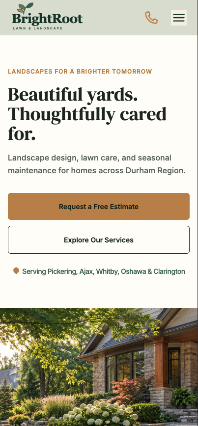
</p>

---

### Services Page

**Desktop —** Service categories, process information and service-request actions.

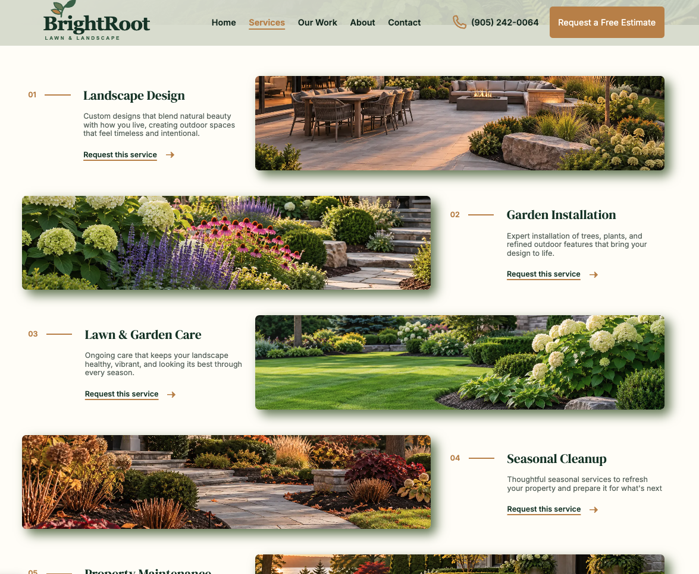

**Mobile —** Stacked service content designed for easy scanning.

<p align="center">
  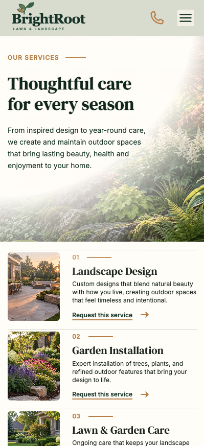
</p>

---

### Projects Page

**Desktop —** Residential project gallery with varied image compositions.

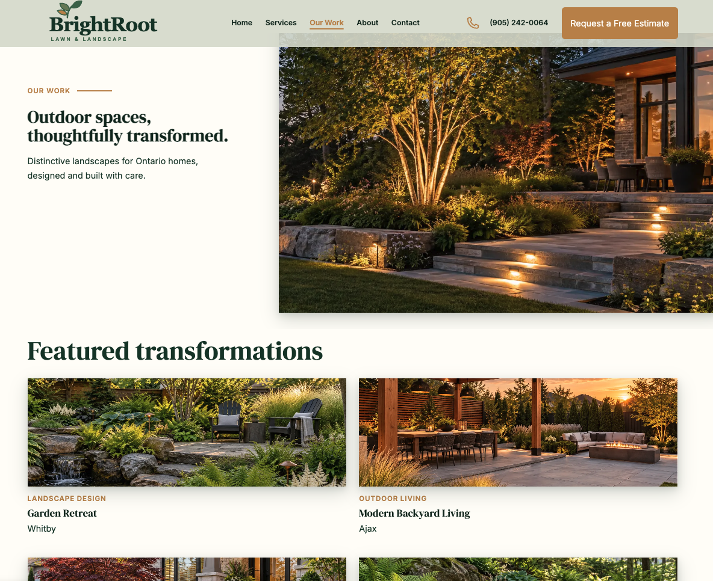

**Mobile —** Single-column project presentation with full-width imagery.

<p align="center">
  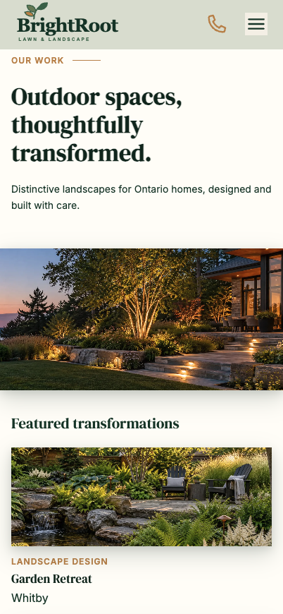
</p>

---

### About Page

**Desktop —** Company story, guiding principles and testimonial content.

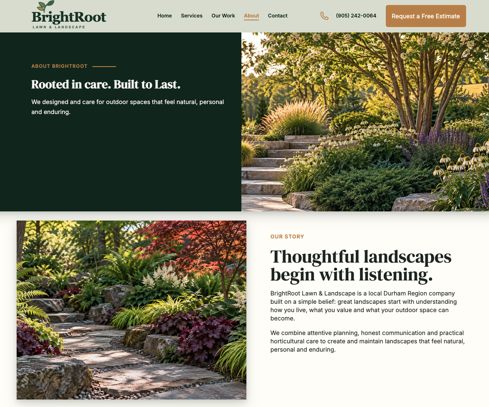

**Mobile —** Responsive company narrative and values sections.

<p align="center">
  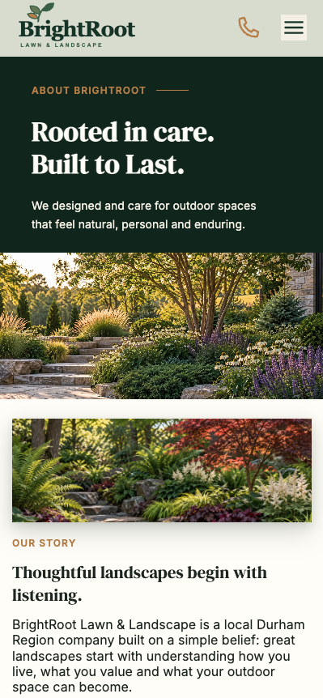
</p>

---

### Contact Page

**Desktop —** Contact information and business details presented in a balanced layout.

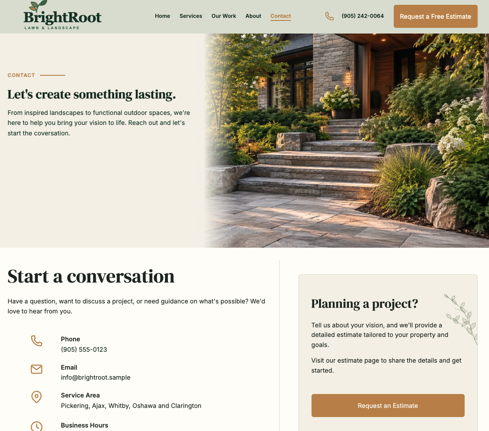

**Mobile —** Compact contact experience with clear communication options.

<p align="center">
  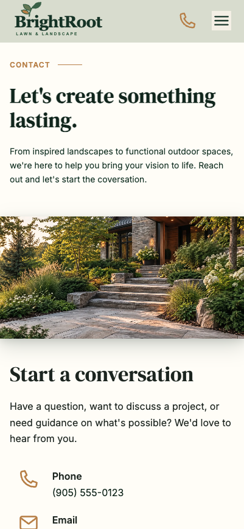
</p>

---

### Contact Inquiry Form

**Desktop —** Streamlined form for general service questions and customer inquiries.

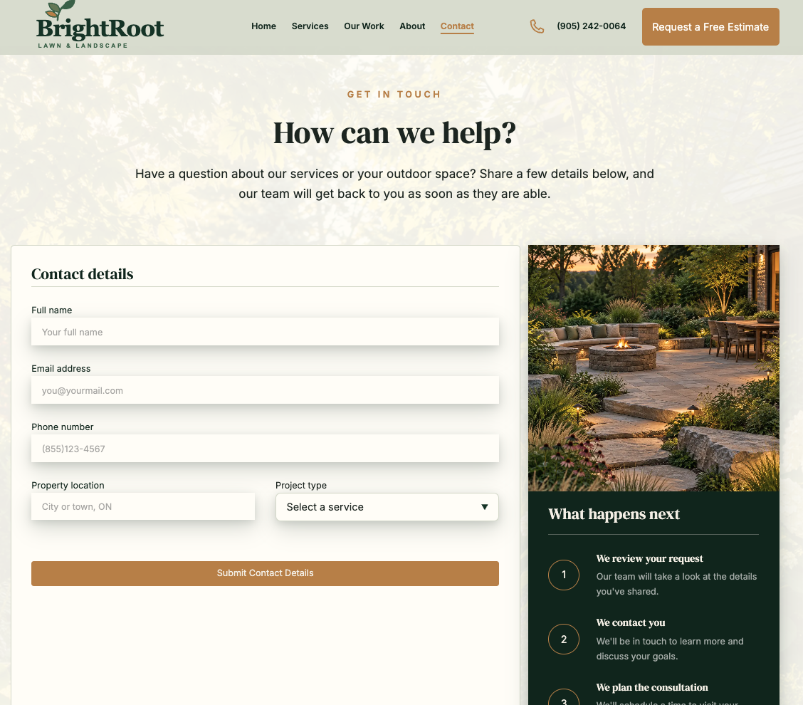

**Mobile —** Touch-friendly general inquiry form.

<p align="center">
  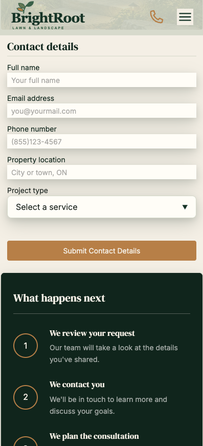
</p>

---

### Estimate Page

**Desktop —** Detailed project form with supporting request information.

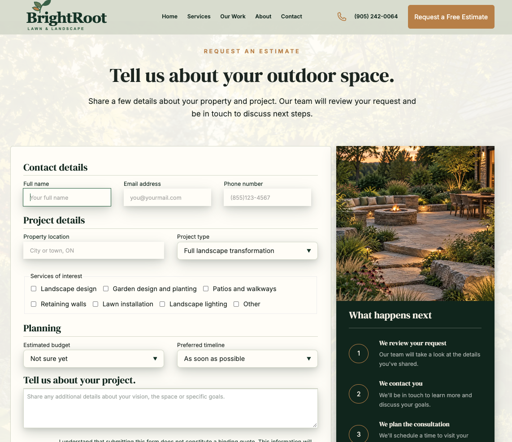

**Mobile —** Stacked estimate workflow optimized for smaller screens.

<p align="center">
  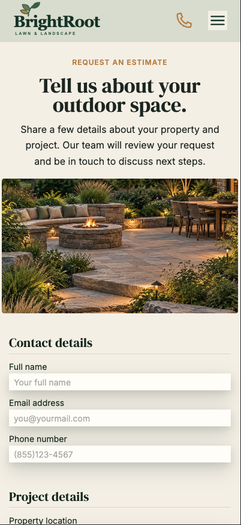
</p>

---

### Not Found Page

**Desktop —** Branded 404 layout with clear recovery actions.

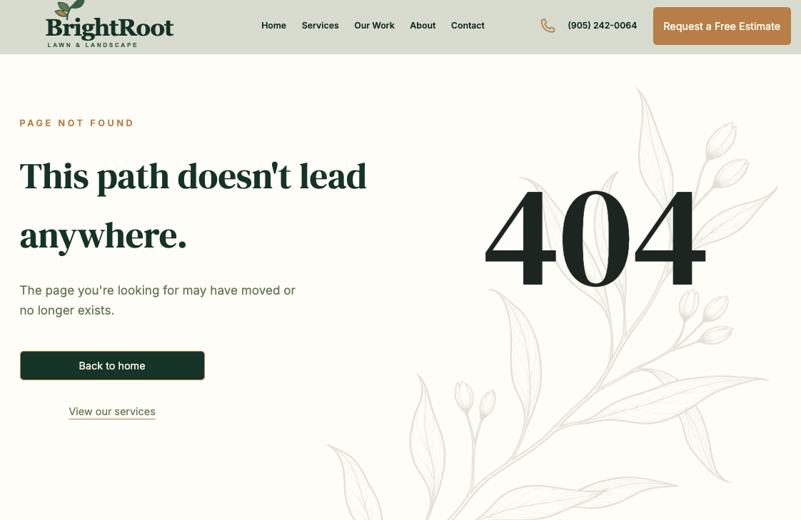

**Mobile —** Compact Not Found experience with direct navigation options.

<p align="center">
  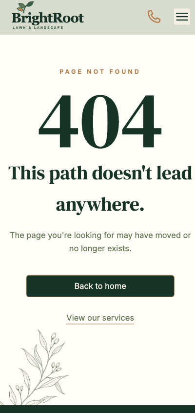
</p>

---

## 🏗️ Project Structure

```text
bright-root-landscaping/
├── frontend/
│   ├── public/
│   ├── src/
│   │   ├── assets/
│   │   ├── components/
│   │   ├── data/
│   │   ├── pages/
│   │   ├── sections/
│   │   └── styles/
│   ├── package.json
│   └── vite.config.ts
├── backend/
│   ├── src/
│   │   ├── controllers/
│   │   ├── routes/
│   │   └── server.ts
│   ├── package.json
│   └── tsconfig.json
├── README-assets/
└── README.md
```

---

## 🚀 Running the Project Locally

### Prerequisites

- Node.js
- npm
- A Resend account and API key for email testing

### 1. Clone the repository

```bash
git clone YOUR_REPOSITORY_URL
cd bright-root-landscaping
```

### 2. Start the frontend

```bash
cd frontend
npm install
npm run dev
```

### 3. Configure the frontend environment

Create `frontend/.env`:

```env
VITE_API_URL=http://localhost:3000
```

### 4. Start the backend

```bash
cd backend
npm install
npm run dev
```

### 5. Configure the backend environment

Create `backend/.env`:

```env
PORT=3000
FRONTEND_URL=http://localhost:5173
RESEND_API_KEY=your_resend_api_key
OWNER_EMAIL=your_resend_account_email
RESEND_FROM_EMAIL="BrightRoot Website <onboarding@resend.dev>"
```

Environment files are intentionally excluded from version control.

---

## 🧪 API Testing

The Contact and Estimate endpoints were tested independently through Postman before frontend integration.

Health check:

```text
GET /api/health
```

Email endpoints:

```text
POST /api/contact
POST /api/estimate
```

Requests must include:

```http
Content-Type: application/json
```

---

## 💡 Engineering Highlights

- Converted complete mobile, tablet and desktop visual designs into reusable React components
- Separated page composition, reusable interface components and page-specific sections
- Used TypeScript interfaces and controlled state for form data
- Reused shared option data to keep form labels and submitted values consistent
- Preserved route state through URLs and query parameters where appropriate
- Created separate lightweight inquiry and detailed estimate workflows
- Kept third-party email credentials exclusively on the backend
- Used environment-specific API URLs for local and deployed builds
- Added a branded wildcard route for unknown URLs
- Built the project without relying on a prebuilt component framework

---

## 🎯 Project Purpose

This project was built to demonstrate the ability to translate a provided UI direction into a complete, responsive business website and extend it with practical full-stack functionality.

BrightRoot represents the type of website a local landscaping company could use to establish credibility, present its work, explain its services and convert visitors into qualified customer inquiries.

---

## 👤 About the Developer

Designed as a portfolio-ready business website and independently implemented with React, TypeScript, responsive CSS, Node.js and Express.

The project reflects a focus on reusable frontend architecture, careful responsive implementation, accessible form design and practical integrations for local-service businesses.

---

## 🔮 Possible Future Enhancements

- Production-domain email verification
- Automated confirmation emails for customers
- Server-side schema validation and sanitization
- Rate limiting and spam protection
- Project filtering by service type or location
- Content management for services and project galleries
- Automated tests with Vitest and React Testing Library

---

## 📄 Project Status

The responsive interface and both email API endpoints are complete and locally tested. Production deployment and final live-environment testing are the remaining steps.

